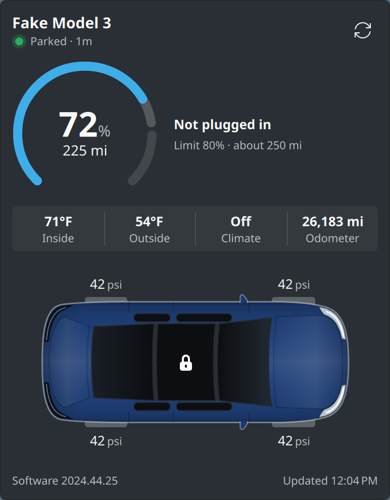
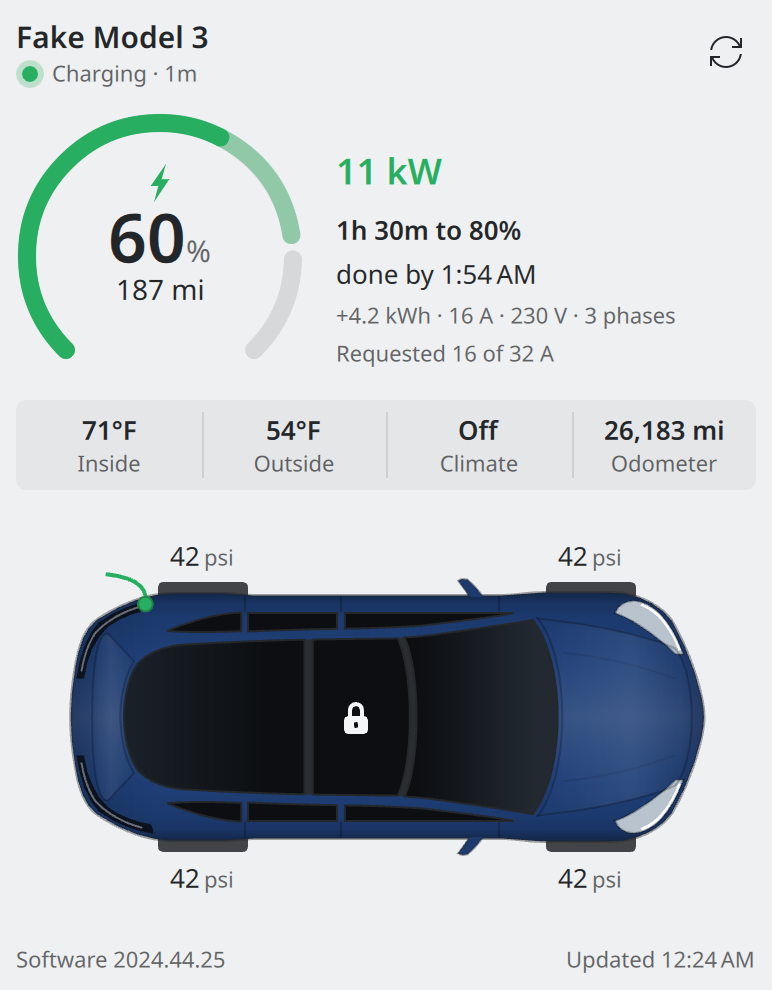
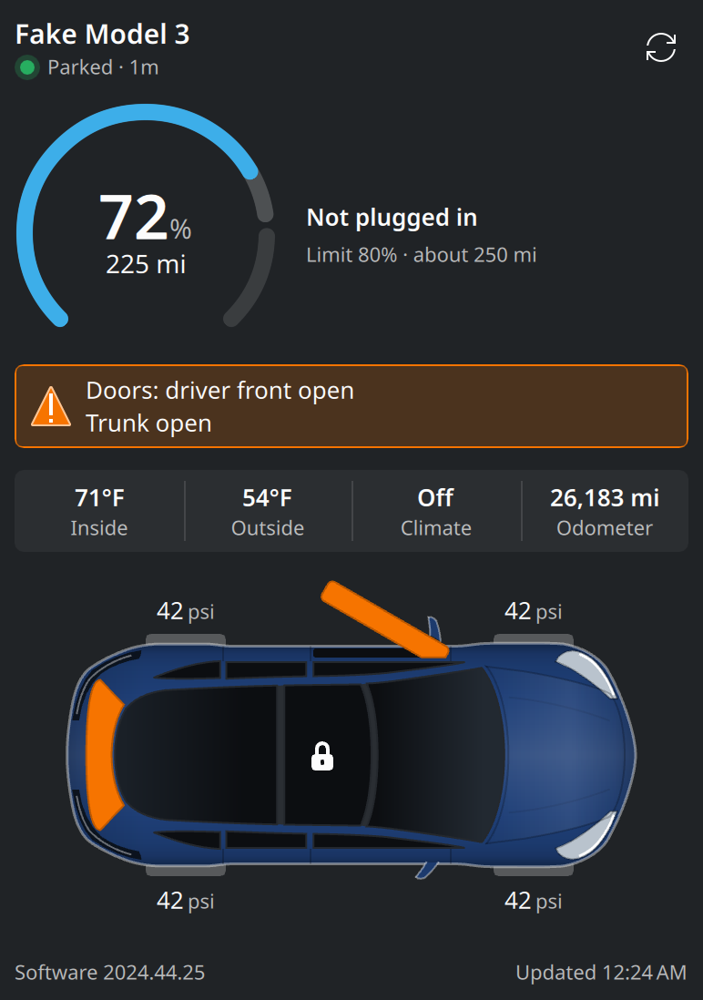
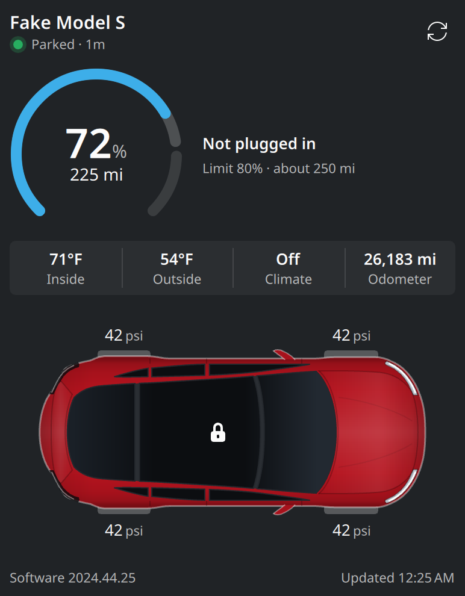
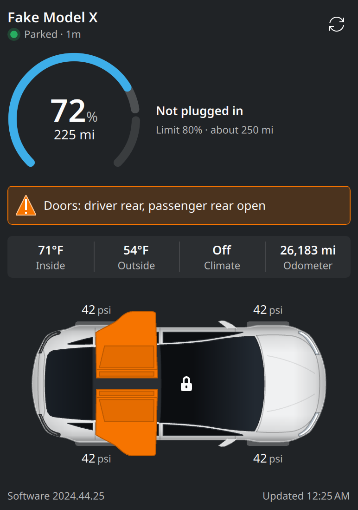
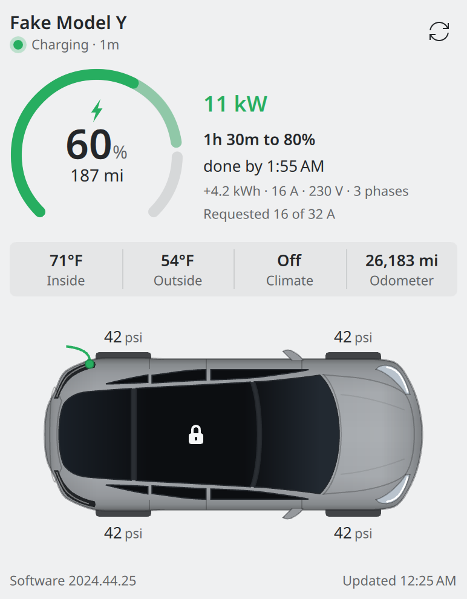
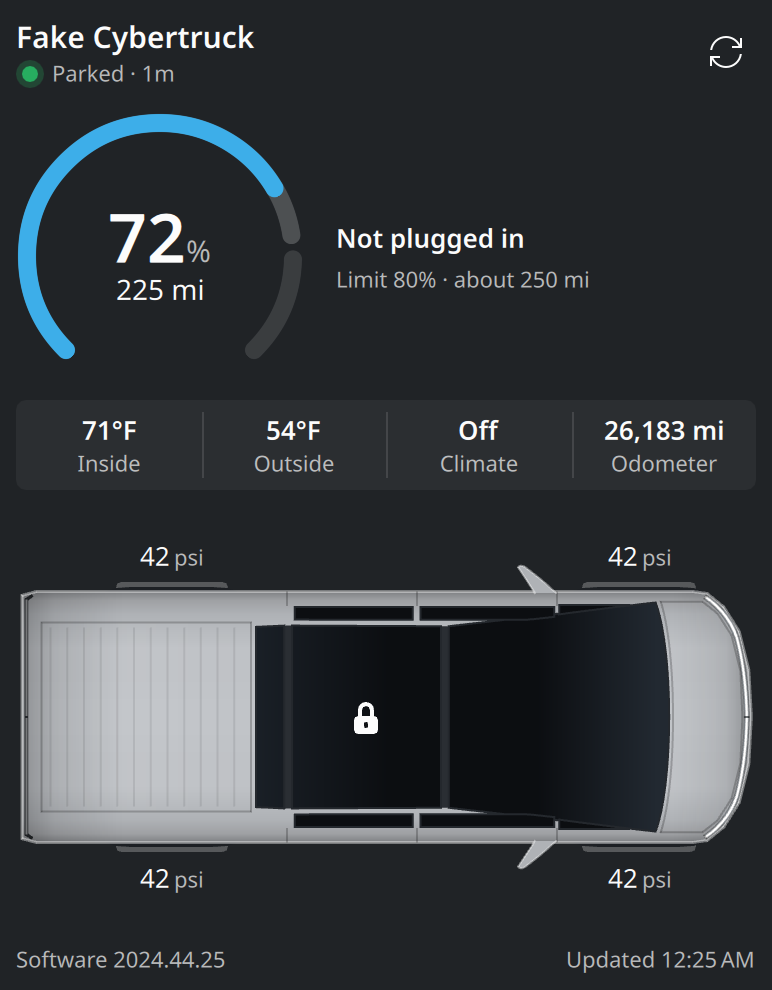

# Tesla Monitor

[](https://github.com/moseph333/tesla-monitor-plasmoid/actions/workflows/ci.yml)
[](https://github.com/moseph333/tesla-monitor-plasmoid/releases/latest)
[](LICENSE)


> An unofficial community project. It isn't affiliated with or endorsed by Tesla, Inc. or the TeslaMate project. See [Disclaimer](#disclaimer).

A KDE Plasma 6 widget that shows a Tesla's status from [TeslaMate](https://docs.teslamate.org), over MQTT or through the [TeslaMate API](https://github.com/tobiasehlert/teslamateapi), straight from the [Tesla Fleet API](https://developer.tesla.com/docs/fleet-api), or from [Teslemetry](https://teslemetry.com), [Tessie](https://tessie.com) or [Home Assistant](https://www.home-assistant.io). On the desktop it's a full card. In a panel it's a battery icon in the shape of your car, a Model S, 3, X, Y or Cybertruck, with the battery percentage or the range beside it, that opens the card when clicked. It's drawn like Plasma's battery icon: a thin outline with a solid fill that grows from left to right, and a bolt while charging. The panel icon also works from the keyboard, where Space or Enter opens the card, and screen readers read out the same status as its tooltip.

<p>



</p>
<p>




</p>

The card on Plasma 6.8 with the data of `tools/fake-teslamate.sh`: a Model 3 above, and a Model S, a Model X with its rear doors up, a Model Y and a Cybertruck below.

The card shows:

- The car's name, what it's doing, the TeslaMate geofence it's in and for how long, such as "Parked · Home · 3h". If you set TeslaMate's address in the settings, clicking the name opens TeslaMate in your browser
- Battery level and range in a ring. A gap in the track marks the charge limit, and the track up to it is a shade stronger than beyond it. Where a gap can't show, with the level above the limit or a limit from 95%, a notch marks it instead. Below 10% the level turns red unless the car is charging. While charging, a bolt sits above the level and the stretch still to charge takes the ring's color and pulses slowly while the popup is open, and the card shows the power, the time left with when it'll be done, the energy added, current and voltage with the number of phases, and the current the car asks for when that's less than the charger offers. Otherwise it says whether the car is plugged in, finished charging, stopped early, waiting for a scheduled start, or plugged into a charger that has no power, and gives the charge limit with about how far a charge to it goes
- While driving, the power the battery gives, or takes back while regenerating. If you turn on navigation, also the destination, the time to arrival with any traffic delay, the distance left and the battery level on arrival
- How much of the battery is usable while it's cold
- Inside and outside temperature, climate and odometer
- A top-down drawing of the car, as the model it is and in its own paint, lying on its side with its nose to the right so it fills the card, with each tire's pressure, each door and window, the trunk, frunk and charge port, the lock and Sentry. Open doors swing out, a Model X's rear doors lift like the wings they are, a hatchback's rear window opens with its trunk, anything open turns orange, a low tire turns red, the charge cable shows while plugged in, and a red lens on the windshield means Sentry is on. Hover over the car to see the same status as text. The paint is the one TeslaMate reports. When it reports none, or one the widget doesn't know, the car is drawn in tints of your color scheme, which you can also choose in the settings
- One warning that lists everything that needs attention: open doors, windows, frunk, trunk, sunroof or charge port, the car unlocked with nobody inside, low tire pressure, service mode, and TeslaMate having trouble reaching the car. The popup is a little taller while it shows, so the car keeps its size. The panel icon's tooltip lists the same
- Software version, available updates and their download and install progress

It can also send desktop notifications when charging finishes or stops early, when something is left open or the car is unlocked with nobody inside, when a tire's pressure is low, and when a software update is available. See [Notifications](#notifications).

The widget runs `mosquitto_sub` every 15 seconds by default, and every 2 minutes while the car sleeps and the popup is closed, to read TeslaMate's retained messages from the broker. It never talks to the car. Opening the popup, or pressing the refresh button in its header, updates right away. The TeslaMate API and Home Assistant are asked as often. With the Tesla Fleet API and Teslemetry, it asks every 5 minutes by default, lets the car fall asleep, and only asks whether it's still asleep every 15 minutes. See [Tesla Fleet API](#tesla-fleet-api). Tessie is asked every 5 minutes too, and every 15 while the car sleeps, but answers from its own copy, so asking never keeps the car awake. See [Other data sources](#other-data-sources). If the broker or the service stops answering, the card keeps the last data and fades it, the panel icon dims, and the card's footer and the icon's tooltip say when the data was last updated, with the day once that wasn't today.

**Contents:** [Requirements](#requirements) · [Install](#install) · [Settings](#settings) · [TLS](#tls) · [Tesla Fleet API](#tesla-fleet-api) · [Other data sources](#other-data-sources) · [Notifications](#notifications) · [Security and privacy](#security-and-privacy) · [TeslaMate behavior](#teslamate-behavior) · [Troubleshooting](#troubleshooting) · [Development](#development) · [Contributing](#contributing)

## Requirements

- Plasma 6
- KNotifications' QML module, `org.kde.notification`. Most distributions ship it with KNotifications. Where it's a separate package, install it, or the widget won't load
- `secret-tool`, to keep the broker password and the tokens in the wallet. Fedora and Arch include it in libsecret, which is usually installed already. On Debian and Ubuntu: `sudo apt install libsecret-tools`. Without it, they're saved in plain text. See [Security and privacy](#security-and-privacy)

For TeslaMate:

- `mosquitto_sub`:
  - Fedora: `sudo dnf install mosquitto`
  - Debian and Ubuntu: `sudo apt install mosquitto-clients`
  - Arch: `sudo pacman -S mosquitto`
  - The snap isn't supported. It only provides `mosquitto.sub`, which the widget can't find.
  - TLS with the system's certificates needs mosquitto 2.0 or newer.
- TeslaMate with MQTT enabled, and a broker this machine can reach

For the Tesla Fleet API, nothing to install: an access token for it (see [Tesla Fleet API](#tesla-fleet-api)), or for a service that offers the same API. `tools/tesla-login.py`, which gets the tokens, needs Python 3.9 or newer.

For the other sources, nothing to install either (see [Other data sources](#other-data-sources)):

- TeslaMate API: [TeslaMateApi](https://github.com/tobiasehlert/teslamateapi) running next to TeslaMate, with MQTT enabled
- Teslemetry or Tessie: an account and an access token from it
- Home Assistant: its Tesla Fleet, Teslemetry or Tessie integration set up, and a long-lived access token

## Install

### From a release

1. Download `tesla-monitor-<version>.plasmoid` from the [latest release](https://github.com/moseph333/tesla-monitor-plasmoid/releases/latest).
2. Right-click the desktop or a panel, choose **Add or Manage Widgets…**, then **Get New → Install Widget From Local File…**, and pick the file.

Or from a terminal, where `-i` installs and `-u` upgrades an installed copy:

```bash
kpackagetool6 -t Plasma/Applet -i tesla-monitor-*.plasmoid
```

### From source

Building needs `zip`, and installing needs `kpackagetool6`, which comes with Plasma:

```bash
git clone https://github.com/moseph333/tesla-monitor-plasmoid.git
cd tesla-monitor-plasmoid
make install
```

`make install` also upgrades an installed copy. Run `make reload`, or log out and back in, so Plasma loads the new version.

Then add **Tesla Monitor** to a panel or the desktop and open its settings.

### Uninstall

Remove the widget from your panels and desktop, then:

```bash
kpackagetool6 -t Plasma/Applet -r net.moseph.teslamonitor
```

From a source checkout, `make uninstall` does the same.

Each copy of the widget leaves its secrets in the wallet. Delete the entries whose names start with "Tesla Monitor" in KWallet Manager.

## Settings

**Connection**

| Setting | Value |
| ------- | ----- |
| Data source | **TeslaMate (MQTT)**, the default, **Tesla Fleet API**, **TeslaMate API**, **Teslemetry**, **Tessie** or **Home Assistant**. The page shows the settings for the one you choose |
| Host, Port | Your MQTT broker. You can paste a URL such as `mqtts://user@broker:8883`, and the widget moves the port, TLS and username into their own fields |
| Username, Password | A broker account, if the broker requires one. The password is kept in the wallet. A password without a username isn't sent, since MQTT has no such login |
| Use TLS, CA file | For a broker that uses TLS. See [TLS](#tls) |
| Topic prefix | `teslamate/cars/1`, or `teslamate/<namespace>/cars/1` if TeslaMate sets `MQTT_NAMESPACE` |
| Every (under Refresh) | 15 seconds by default |
| While the car sleeps | 2 minutes by default. Used while the car is asleep or offline and the popup is closed. A widget on the desktop has no popup, so it uses this whenever the car sleeps. It never polls faster than **Every** |

For the Tesla Fleet API:

| Setting | Value |
| ------- | ----- |
| Region | Where your Tesla account's data lives: North America and Asia-Pacific, Europe, Middle East and Africa, or China. **Custom URL** is for a service that offers the Fleet API's URLs, and must use HTTPS unless it's on this computer |
| Access token | A Fleet API access token with the `vehicle_device_data` scope |
| Refresh token, Client ID | Optional. With both, the widget renews the access token when it expires and saves the new tokens in the wallet. **Token server** is Tesla's unless you change it, and must use HTTPS unless it's on this computer |
| VIN | The car to show. **Find Cars** fills it in |
| Every (under Refresh) | 5 minutes by default, and never less than 1 |
| While the car sleeps | 15 minutes by default. Also used while the widget lets an awake car fall asleep |

For the other sources:

| Source | Setting | Value |
| ------ | ------- | ----- |
| TeslaMate API | Address | TeslaMateApi's address, such as `http://teslamate.local:8080`. `http://` is added if you leave it out |
| | Token | Optional. TeslaMateApi's `API_TOKEN`, for a server that asks for it |
| | Car ID | TeslaMate's ID for the car, 1 for the first |
| Teslemetry | Access token, VIN | A token from the Teslemetry console, and the car to show |
| Tessie | Access token, VIN | A token from Tessie's dashboard, and the car to show |
| Home Assistant | Address | Home Assistant's address, such as `http://homeassistant.local:8123` |
| | Access token | A long-lived access token, from your Home Assistant profile |
| | Car | The start of the car's entity IDs, such as `my_model_3` for `sensor.my_model_3_battery_level` |

The TeslaMate API and Home Assistant use the TeslaMate refresh settings, in seconds. Teslemetry and Tessie use the Fleet API's, in minutes.

**Test Connection** tries the values on the page before you apply them, and says what went wrong if it can't read the car's data. **Find Cars** lists the cars TeslaMate publishes on the broker or knows of, the cars on the Tesla, Teslemetry or Tessie account, or the cars Home Assistant has, and fills in the topic prefix, car ID, VIN or car, or lets you choose when there are several.

**Display**

| Setting | Value |
| ------- | ----- |
| Distance, Temperature, Tire pressure | Automatic by default, which follows Measurement units in System Settings, Region & Language: miles, °F and psi for the US, miles, °C and psi for the UK, and kilometers, °C and bar otherwise. Each can be set on its own, and tire pressure can also be kPa. Speed uses the distance unit. A widget set up before 1.5 keeps the units it showed |
| Range | Rated (matches the car), estimated or ideal |
| Show text next to the icon | On by default. Turn it off to show only the car in the panel. Hovering over the car still shows the percentage and range |
| Text | What the panel shows next to the car: the battery percentage (the default), the range, or both |
| While charging, show the time to full | Off by default. While the car charges, the panel shows the time left to reach the charge limit, instead of the range when Text includes it |
| Model | **Automatic** by default: the panel icon and the car in the card take the shape of the model TeslaMate reports in its `model` topic, and of a Model 3 when it reports none. Or choose Model S, Model 3, Model X, Model Y or Cybertruck yourself |
| Right-hand drive | Off by default. TeslaMate names doors and windows by driver and passenger side, so turn this on if the steering wheel is on the right |
| Car color | **The car's paint** by default: the drawing's body takes the color TeslaMate reports as `exterior_color`. **Theme colors** draws it in tints of your color scheme instead, which is also what you get when TeslaMate reports no paint or one the widget doesn't know |
| Show the destination and arrival while driving | Off by default. While the car follows a route, the card shows the destination, the time to arrival with any traffic delay, the distance left and the battery level on arrival. Needs TeslaMate 1.29 or newer |
| Unlocked is OK at | TeslaMate geofence names, or Home Assistant zone names, separated by commas, such as `Home, Work`. There an unlocked car isn't shown as a warning or notified, for a garage or home where you leave it unlocked on purpose |
| TeslaMate | TeslaMate's web address, such as `http://teslamate.local:4000`. Clicking the car's name in the popup, or **Open TeslaMate** in the widget's context menu, opens it in your browser. `http://` is added if you leave it out. With Home Assistant, Teslemetry or Tessie as the data source, they open Home Assistant, the Teslemetry console or Tessie's web app instead |

**Notifications**

| Setting | Value |
| ------- | ----- |
| Notify when | Charging finishes, charging stops early or the charger loses power, something is left open, the car is unlocked with nobody inside, a tire's pressure is low, or a software update is available. All are on by default. See [Notifications](#notifications) |
| For at least | 10 minutes by default. How long something has to stay open, or the car unlocked with nobody inside, before the widget notifies |

Each copy of the widget keeps its own settings, and its own password and tokens in the wallet. See [Security and privacy](#security-and-privacy) for where they go.

## TLS

Turn on **Use TLS** for a broker that encrypts its connections. TLS brokers usually listen on port 8883, so the widget switches the port between 1883 and 8883 along with the checkbox, unless you've set a different one. With mosquitto 2.0 or newer, port 8883 always uses TLS.

- Leave **CA file** empty to trust the system's certificates. This needs mosquitto 2.0 or newer.
- For a broker with a self-signed certificate or one from a private CA, choose that CA's certificate, usually a `.pem` or `.crt` file, as the CA file.
- **Host** must be a name the broker's certificate lists, which is usually its host name rather than its IP address.

## Tesla Fleet API

Tesla's [Fleet API](https://developer.tesla.com/docs/fleet-api) gives the car's data without TeslaMate. The widget reads it with pasted tokens. It has no Tesla login of its own.

**Tokens.** Tesla only issues Fleet API tokens to a registered app, so you register your own once, and `tools/tesla-login.py` does the rest. (Or use a service that offers the same API with its own token, and choose **Custom URL**.)

1. At [developer.tesla.com](https://developer.tesla.com), create an app with:
   - your domain as its allowed origin, such as `https://example.com`;
   - `http://localhost:8585/callback` as a redirect URI;
   - the vehicle information scope (`vehicle_device_data`).

   Note its client ID and client secret.
2. Tesla wants the app's public key on that domain before it answers any request. Make a key pair, keep `private-key.pem` to yourself, and publish the public key at `https://example.com/.well-known/appspecific/com.tesla.3p.public-key.pem`:

   ```bash
   openssl ecparam -name prime256v1 -genkey -noout -out private-key.pem
   ```

   ```bash
   openssl ec -in private-key.pem -pubout -out com.tesla.3p.public-key.pem
   ```

3. Register the app with the Fleet API, once for each region you use (`--region eu` for Europe, Middle East and Africa, `--region cn` for China). It asks for the client secret, or reads `TESLA_CLIENT_SECRET`:

   ```bash
   tools/tesla-login.py register --client-id <client ID> --domain example.com
   ```

4. Sign in. This opens Tesla's sign-in page in your browser, catches the browser coming back, and prints what to paste into the widget's Connection settings: region, access token, refresh token, client ID and VIN.

   ```bash
   tools/tesla-login.py login --client-id <client ID>
   ```

   Your Tesla password only goes to Tesla's page, and the tokens are only printed, never saved. If Tesla won't take a `localhost` redirect URI, give the app another one, run `login` with `--redirect-uri <it> --manual`, and paste the address the browser ends up on. `--json` prints the result as JSON.

Tesla's access tokens last 8 hours. With the refresh token and client ID, the widget renews the access token and saves the new tokens in the wallet. Renewing invalidates the old refresh token, so don't use the same tokens in another program. Copies of the widget share renewals. A refresh token expires after 3 months unused, so a widget that has been off that long needs a new sign-in.

**Cost.** Tesla bills each request, roughly $1 for every 500 data requests (the rate varies by region), with a $10 monthly credit for individual developers. Every request counts, including the replies for a sleeping car. With the default settings, a car that's awake 3 hours a day costs about 4,000 requests a month. Services that offer the same API have their own prices.

**Sleep.** Asking an awake car for its data keeps it awake, which drains the battery. The widget never wakes the car. While the car sleeps it only asks for the car's state, which doesn't reach the car. Once an awake car has been parked with nothing going on for 15 minutes, the widget only asks for its state for 21 minutes, as TeslaMate does, and the card says "Falling asleep". Then it looks once more. Driving, charging, climate, an update, someone inside or an open door, frunk or trunk keep it asking. Opening the popup or pressing refresh fetches the data, at most once a minute, but never wakes a sleeping car. While the car sleeps the card keeps the last data.

**Differences from TeslaMate.**

- There are no geofences, so **Unlocked is OK at** doesn't apply, and the card doesn't name a place.
- There is no warning that TeslaMate is having trouble reaching the car.
- How long the car has been in its state ("Parked · 3h") only counts from a change the widget saw.
- With navigation on, the widget also asks for the car's location, which on recent software shows a location sharing icon in the car.

## Other data sources

All of these read what another program already fetched from the car, so the widget itself never reaches the car.

### TeslaMate API

[TeslaMateApi](https://github.com/tobiasehlert/teslamateapi) is a small web service that runs next to TeslaMate and answers with what TeslaMate publishes over MQTT. Use it when this computer can't reach the MQTT broker, or you'd rather not install `mosquitto_sub`. It shows the same things as TeslaMate over MQTT, geofences included, except each window on its own: it only says whether some window is open.

- It listens on port 8080 and needs `MQTT_HOST` and MQTT enabled. Reading the car needs no token. If your server asks for its `API_TOKEN`, put that in **Token**.
- It converts lengths, pressures and temperatures to the units set in TeslaMate, and the widget converts them back, so the widget's own unit settings still apply.
- Until it has received a value over MQTT, it reports 0, an empty name or false. The widget treats a tire pressure, charge limit or battery of 0 as unknown. After TeslaMateApi restarts, it may say for a few minutes that TeslaMate is having trouble reaching the car.

### Teslemetry

[Teslemetry](https://teslemetry.com) offers the Tesla Fleet API's URLs with its own access token, made once in its console, which doesn't expire and needs no refresh token or client ID. **Find Cars** fills in the VIN. Teslemetry answers from a cache that it keeps fresh for 20 minutes, for free, and charges credits when it has to ask the car. The widget treats it like the Fleet API: it lets the car sleep, and asks for the car's location only when navigation is on. Like the Fleet API, it has no geofences and no warning about TeslaMate.

### Tessie

[Tessie](https://tessie.com) keeps the car's latest data and serves it to the widget, which reads it every 5 minutes by default. Tessie doesn't charge for each request, so every minute costs nothing more, and asking never wakes the car or keeps it awake. While the car sleeps, the card keeps showing what Tessie last knew. Make an access token in Tessie's dashboard, under **Settings → API**. **Find Cars** fills in the VIN. Tessie has no geofences.

### Home Assistant

The widget reads the car from Home Assistant's REST API, as Home Assistant's own [Tesla Fleet](https://www.home-assistant.io/integrations/tesla_fleet/), [Teslemetry](https://www.home-assistant.io/integrations/teslemetry/) or [Tessie](https://www.home-assistant.io/integrations/tessie/) integration provides it. Home Assistant converts values to its unit system, and the widget converts them back. The car's zone counts as its geofence.

- Make a long-lived access token in your Home Assistant profile, under **Security**.
- **Car** is the start of the car's entity IDs. Home Assistant names them after the car and the entity, such as `sensor.my_model_3_battery_level` for a car called My Model 3, so the car is `my_model_3`. **Find Cars** lists the cars it has.
- The widget finds the entities by Home Assistant's English names. If Home Assistant runs in another language, it may have named them in that language when the car was added, and the widget won't find them. Renamed entities aren't found either. Rename them back to the English IDs, or use another source.
- Entities Home Assistant turns off by default, such as Teslemetry's odometer and power, stay empty on the card until you turn them on.
- Each poll downloads the state of every entity in Home Assistant, so on a large installation you may want a longer refresh interval.
- Home Assistant doesn't give the car's model or paint, so the car is drawn as the **Model** setting says, and in theme colors.

## Notifications

The widget sends a notification when:

- Charging finishes. A charge that adds less than 3% doesn't count, so the car topping itself up stays quiet.
- Charging stops before the limit, or the charger stops supplying power during a charge. The widget waits about 3 minutes in case the charge carries on, and tells you once per plug-in. Unplugging and waiting for a scheduled start never notify.
- A door, window, the frunk, trunk, sunroof or charge port is left open, or the car is unlocked with nobody inside, for 10 minutes (**For at least**) while nobody is in the car. Each notifies once, and again only after it has been closed or locked.
- A tire's pressure is low, or a software update is available.

Notifications are only for changes. Nothing is sent for what's already the case when the widget starts, after you change the connection settings, or after a long break in the data, such as while the computer sleeps. Plasma shows them as System Notifications, and clicking one opens the widget. Copies of the widget that show the same car, such as one in the panel and one on the desktop, send each notification once.

If you leave the car unlocked on purpose somewhere, such as in your garage at home, add that TeslaMate geofence or Home Assistant zone to **Unlocked is OK at** on the Display page. The widget then neither warns nor notifies there.

## Security and privacy

With TeslaMate, the widget only reads from the MQTT broker. It never contacts the car or Tesla's servers, and sends nothing anywhere else. With the Tesla Fleet API, it only contacts the API's URL and the token server, and only reads from them. With the other sources, it only reads from TeslaMateApi, Teslemetry, Tessie or Home Assistant.

- The broker password is kept in the wallet: KWallet on Plasma, or another Secret Service such as GNOME Keyring or KeePassXC. The widget reaches it through `secret-tool` and hands it to `mosquitto_sub` through a pipe, so it's neither in Plasma's settings file nor on a command line, where other users of this computer could see it in the process list. Each copy of the widget has an entry of its own, called "Tesla Monitor MQTT password".
- The password is on a command line only briefly: while `secret-tool` saves a new one when you apply it, and while **Test Connection** or **Find Cars** tries one you've typed but not applied. A password over 1000 bytes is too long for the pipe, so it goes on `mosquitto_sub`'s command line at every poll.
- Without `secret-tool` or a wallet, Plasma stores the password and the tokens in plain text, and the widget passes the password to `mosquitto_sub` on the command line. The Connection page says when that's the case.
- Use a broker account that can only read TeslaMate's topics, wherever the password is kept.
- The widget never uses the car's position (`latitude`, `longitude`, `location`, `heading`, `elevation`) or the older `active_route_*` topics, so the account can be denied those. It shows the navigation destination (`active_route`) only when **Show the destination and arrival while driving** is on, but it still receives that topic with everything else under the prefix, so deny it too if you don't use navigation.
- Use TLS if the broker is reachable from outside your home network.
- The tokens of every source, the Fleet API's access and refresh tokens and the Teslemetry, Tessie, TeslaMate API and Home Assistant tokens, are kept in the wallet too, all in one entry called "Tesla Monitor tokens". They're on a command line only while `secret-tool` saves them: when you apply new ones, and when the widget renews the Fleet API's, about every 8 hours. If the wallet refuses renewed tokens, the widget keeps the tokens in the settings in plain text rather than lose them, since the old ones no longer work.
- The Fleet API's tokens are only sent in HTTPS headers: the widget refuses a custom URL or token server that uses plain HTTP, unless it's on this computer, such as a local proxy. Anyone with the tokens can read the car's data until they expire, or for as long as the refresh token works.
- The other sources' tokens are only sent in their requests' headers too. Teslemetry's and Tessie's don't expire, so revoke one you no longer use. A Home Assistant token can do anything your Home Assistant user can, so make it for a user that isn't an administrator if you can, and use HTTPS if Home Assistant is reachable from outside your home network. The TeslaMate API and Home Assistant are often reached over plain HTTP at home, where the token travels unencrypted.

To report a security problem, see [SECURITY.md](SECURITY.md).

## TeslaMate behavior

- TeslaMate creates its MQTT publishers only for cars that exist when it starts. Restart TeslaMate after adding a car, or the broker stays empty.
- After a restart, values appear on the car's next state change. Some, such as tire pressures, need the car to be awake.
- TeslaMate reports each door separately from 1.30 and each window from 4.1.1. With older versions it only says that some door or window is open, so the card outlines all four windows in orange, draws an orange line along the outer edge of all four doors, and the doors don't swing out.
- Whether a charge finished, stopped early or has no power needs TeslaMate 1.28 or newer. Older versions only show whether the car is charging or plugged in.
- Navigation needs TeslaMate 1.29 or newer, which publishes `active_route`. The widget doesn't fall back to the older `active_route_destination`, which has no arrival details and reads `nil` between routes (TeslaMate 1.28.4 and 1.28.5 kept the last destination there instead).
- Update download and install progress, and service mode, need TeslaMate 4.1 or newer.
- TeslaMate 2.1 and newer don't retain `healthy`, so the widget only sees it when a poll happens to catch it, and keeps it for 10 minutes. The warning that TeslaMate is having trouble reaching the car can lag or be missed.
- From TeslaMate 4.4, values the car stops reporting disappear from the card.
- TeslaMate reports the paint as the car names it, such as `DeepBlue`, `PearlWhite` or `RedMulticoat`. The widget knows Tesla's paints by the words in those names and draws a close color, not the exact one. For any other name it uses theme colors.

## Troubleshooting

**The card stays empty or says it's waiting for data.** Press **Test Connection** in the settings, which says what went wrong. If the broker answers but has nothing under the prefix, use **Find Cars** to fill in the right topic prefix. TeslaMate only publishes cars that existed when it started, so restart it after adding a car, and some values only appear once the car wakes up.

**The widget won't load, or shows an error instead of the card.** Install KNotifications' QML module, `org.kde.notification`, if your distribution packages it separately, then run `make reload` or log out and back in.

**It couldn't get the broker password or the tokens from the wallet.** The wallet is closed, or the secret isn't in it any more. Open the wallet when it asks, then press **Refresh** or open the popup. Until then the widget doesn't poll, so a closed wallet doesn't ask to be opened every few seconds. If that doesn't help, enter the password or the token again in the settings.

**It says `mosquitto_sub` isn't installed.** Install it from your distribution's packages, as listed under [Requirements](#requirements). The snap isn't supported.

**TLS fails.** Check that **Host** is a name the broker's certificate lists, that the CA file is the one that signed it, and that mosquitto is 2.0 or newer if the CA file is empty. See [TLS](#tls).

**No notifications.** Check that they're turned on in the widget's Notifications page and in **System Settings → Notifications**. Notifications are only for changes, so nothing is sent for what was already the case when the widget started.

**Seeing what went wrong.** Plasma logs the widget's errors to the journal:

```bash
journalctl --user -b -u plasma-plasmashell | grep -i -A3 tesla
```

If that doesn't explain it, [open an issue](https://github.com/moseph333/tesla-monitor-plasmoid/issues/new/choose) with the widget, Plasma and TeslaMate versions.

## Development

Edit the files in `package/`, then:

```bash
make install   # build dist/tesla-monitor.plasmoid and install or upgrade it
make reload    # restart Plasma so the new QML loads
make test      # run the unit tests
make lint      # check QML syntax, metadata.json, main.xml and the tools
```

`make reload` makes the panel and desktop blink, and it clears Plasma's notifications. `make help` lists every target. For each release, raise `Version` in `package/metadata.json` and describe the changes under a matching heading in [CHANGELOG.md](CHANGELOG.md). Once that reaches `master`, the release workflow tags the commit, such as `v1.10.0`, and publishes the `.plasmoid` on GitHub with those notes. Pushing a matching tag yourself does the same. CI runs the tests and `make lint` on every pull request.

`make lint` uses Qt 6's `qmlformat`, `jq`, `xmllint`, `shellcheck` and Python, and skips any that aren't installed.

The tests in `tests/` cover `logic.js`, `models.js`, `notifyhub.js`, `sources.js`, `rest.js`, `teslaapi.js`, `tokenhub.js`, `teslamateapi.js`, `tessie.js` and `homeassistant.js`, which need only Node.js 18 or newer, and `tools/tesla-login.py`, which needs Python 3.9 or newer and runs against the fake Fleet API below. Some of the `logic.js` tests run the wallet commands in `/bin/sh`, with stand-ins for `secret-tool` and `mosquitto_sub`, and are skipped where there's no `/bin/sh` or coreutils. `logic.js` holds the widget's decisions and never calls `Qt` or `i18n()`, so Node can run it; the QML turns its results into words. Qt 6's `qmllint` catches QML syntax errors:

```bash
qmllint package/contents/ui/*.qml package/contents/config/*.qml
```

If it isn't on your `PATH`, look in Qt 6's `bin` folder, such as `/usr/lib/qt6/bin` or `/usr/lib64/qt6/bin`. Outside a Plasma session it can't find Plasma's and Kirigami's modules, so ignore its warnings about those.

### Fake TeslaMate data

`tools/fake-teslamate.sh` publishes made-up TeslaMate values to a broker, so you can try the widget without a car, and see states your car is rarely in. It needs `mosquitto_pub`, which comes with `mosquitto_sub`. Run a broker of your own, from the `mosquitto` package, so nothing lands on a real TeslaMate's topics:

```bash
mosquitto -p 1884 -v                            # in another terminal
tools/fake-teslamate.sh -p 1884 parked          # parked and locked, everything closed
tools/fake-teslamate.sh -p 1884 charging        # then whatever you want to see
```

Set the widget's host to `localhost` and its port to 1884. The values are retained, as TeslaMate's are, so the widget sees them on its next poll. Each scenario changes only its own values, so they combine, and `parked` puts everything back. Run the script without a scenario to see what each one does:

- `parked`, `asleep`, `driving`, `regen`, `route`, `noroute`
- `charging`, `complete`, `stopped`, `nopower`, `scheduled`
- `open`, `close`, `unlock`, `lock`, `present`, `away`, `home`
- `tires`, `tires-empty`, `update`, `downloading`, `installing`
- `cold`, `unhealthy`, `service`
- `car2` adds a second car for **Find Cars**, and `clear` removes everything the script published

`-h` and `-p` choose the broker's host and port, and `-t` the topic prefix, such as `teslamate/<namespace>/cars/1`.

Notifications are for changes, so run a scenario, let the widget poll, then run the next. `charging` and then `complete` notifies that charging finished, and `charging` and then `stopped` notifies about 3 minutes later. `parked` removes `healthy`, as TeslaMate 2.1 and newer don't retain it, so a warning from `unhealthy` stays on the card for 10 minutes.

`parked` also gives the fake car a Deep Blue paint. To see the drawing in another, publish that paint's name:

```bash
mosquitto_pub -p 1884 -r -t teslamate/cars/1/exterior_color -m PearlWhite
```

`parked` also makes the fake car a Model 3. For another shape, publish `S`, `X`, `Y` or `Cybertruck` as its model, or choose one in the settings:

```bash
mosquitto_pub -p 1884 -r -t teslamate/cars/1/model -m Y
```

The shapes are in `models.js`, which is as free of `Qt` as `logic.js` and tested the same way. Each model's side profile and plan use Tesla's published dimensions, and their outlines follow the side and top views in Tesla's owner's manuals.

The card draws its own lock, Sentry and bolt signs instead of taking them from the icon theme, so they look the same in every theme. If you add a theme icon with `isMask: true`, use a `-symbolic` name. Some icon themes, such as WhiteSur, map plain names to full-color icons, which then render as a solid block.

### Fake Tesla Fleet API

`tools/fake-tesla-api.py` serves made-up Fleet API replies on `localhost`, so you can try the API source without a car, an account or a bill. It serves the same car to the other sources too. It needs only Python 3.9 or newer:

```bash
tools/fake-tesla-api.py --expire-first
```

Choose **Tesla Fleet API**, set the Region to **Custom URL** with `http://localhost:8765`, paste `access-1` as the access token, `refresh-1` as the refresh token, `fake` as the client ID and `http://localhost:8765` as the token server, then use **Find Cars**. `--expire-first` refuses the first access token once, so the widget has to renew it. Switch the car's state while it runs:

```bash
curl http://localhost:8765/_scenario/charging
```

The scenarios are `parked`, `charging`, `complete`, `driving`, `open`, `unlocked`, `update`, `asleep` and `offline`.

For the other sources, use `http://localhost:8765` as the address:

- **TeslaMate API**: no token, car ID 1.
- **Home Assistant**: any token, and `blue_thunder` as the car, or use **Find Cars**.
- **Tessie**: its address can't be changed in the settings, so the fake server only helps to look at its replies, such as `curl -H 'Authorization: Bearer x' http://localhost:8765/5YJ3E1EA0KF000001/state`.
- **Teslemetry**: the source always asks Teslemetry. Its replies are the Fleet API's, so try those with the **Tesla Fleet API** source.

It also fakes Tesla's sign-in page, which signs in at once, and app registration, so `tools/tesla-login.py` can be tried against it. Its client secret is `fake-secret` (`--client-secret` changes it), and `--fail-register` makes registration fail. The URL options are hidden from `--help`, since only the fake server needs them:

```bash
export TESLA_CLIENT_ID=fake TESLA_CLIENT_SECRET=fake-secret
```

```bash
tools/tesla-login.py login --api-url http://localhost:8765 --auth-url http://localhost:8765 --token-url http://localhost:8765/oauth2/v3/token
```

## Contributing

Bug reports and pull requests are welcome. See [CONTRIBUTING.md](CONTRIBUTING.md), and [CHANGELOG.md](CHANGELOG.md) for what changed in each version.

## License

[MIT](LICENSE) © 2026 moseph333

## Disclaimer

Tesla Monitor is an independent, unofficial project. It isn't affiliated with, endorsed by or sponsored by Tesla, Inc. or the TeslaMate project. Tesla, Model S, Model 3, Model X, Model Y and Cybertruck are trademarks of Tesla, Inc., used here only to describe what the widget works with. The widget only reads data that your own TeslaMate publishes to your own MQTT broker, or that the Tesla Fleet API gives your own tokens, and is provided as is, without warranty.
